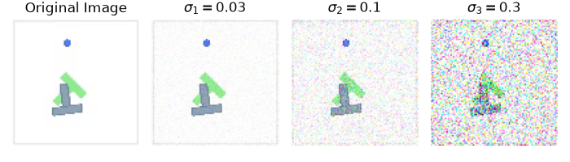
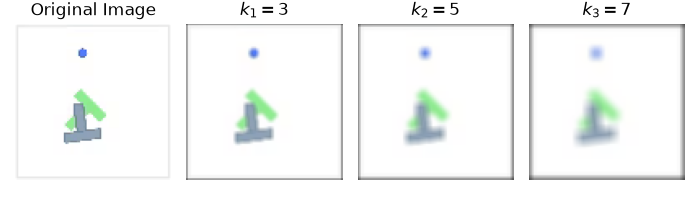
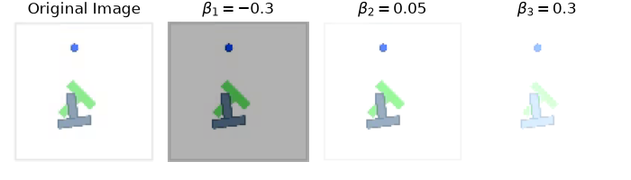

# Probing Visual Robustness in VLA Policies

In this project, we study a SmolVLA policy finetuned on the lerobot/pusht dataset
and evaluated in the PushT simulation environment.
We evaluate the finetuned policy under clean observations and under three visual observation perturbations,
each applied at three severity levels.
This is to study the robustness of the finetuned policy to visual observation perturbations
through artificially generated perturbations as a runnable proxy for real-world visual perturbations.
We then report the closed-loop policy success rate under each visual condition
and analyze robustness through the resulting performance degradation.

The repository contains the code and report for the project.
The final report could be found in the [TBC](TBC) folder.

Here we provide the examples to demonstrate how the visual perturbations are applied to a sample PushT image:

### Gaussian noise

### Blur

### Brightness shift

## Repository Usage

Please refer to [README.md](./src/README.md) inside `src` folder.

## Course Information

Seminar topic: Physical AI: Embodied Intelligence and Real-World Interaction

Course code: CS 8001 OPA

Abstract: This advanced graduate seminar explores the emerging field of Physical AI, where artificial intelligence systems are embodied in physical agents that perceive, reason about, and interact with the real world. Students will examine the intersection of robotics, computer vision, machine learning, and control theory to understand how AI systems can operate effectively in unstructured, dynamic environments. The course covers foundational concepts, current research challenges, and practical applications spanning humanoid robots, autonomous vehicles, manipulation systems, and beyond. Through a combination of paper discussions, guest lectures from industry and academia, and hands-on projects, students will gain deep insights into the unique challenges of deploying AI in physical systems, including real-time constraints, safety considerations, multimodal perception, and the integration of learning with classical control approaches.

Instructor: [Dr. Benjamin Manning](https://space.gatech.edu/benjamin-manning)

## Author

[@wyhwong](https://github.com/wyhwong)
